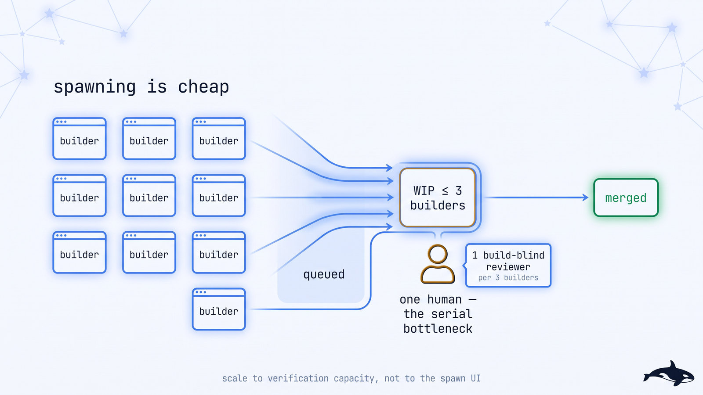
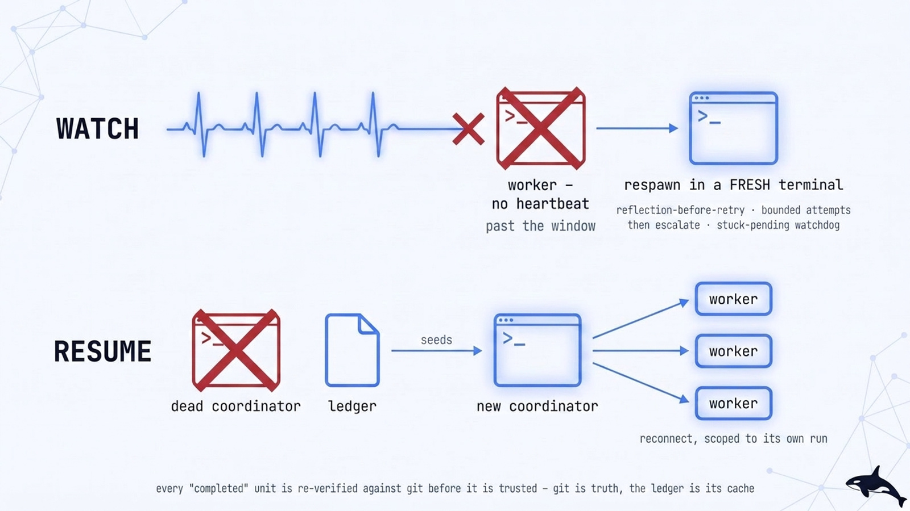
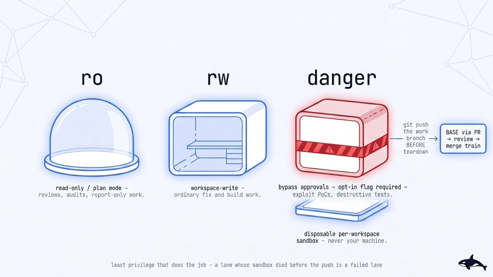

# Concepts — The Mental Model Behind open-fleet

[Documentation Hub](README.md) · [Getting Started](getting-started.md) · [Mission Guides](missions/README.md) · [Architecture](../ARCHITECTURE.md)

The policy files in [`runtime/`](../runtime/) are written as compact, imperative rules for agent coordinators. This guide explains the same architecture for human engineers and operators — why each mechanism exists, which failure mode it prevents, and how the components fit together. Nothing here overrides the runtime policies; when in doubt, the policy file in `runtime/` is the source of truth.

## Contents

- [Glossary](#glossary)
- [Read a run result](#read-a-run-result)
- [A fleet is an outcome, not an ingredient](#a-fleet-is-an-outcome-not-an-ingredient)
- [Coordinators and workers](#coordinators-and-workers)
- [The evidence manifest](#the-evidence-manifest)
- [Independent verification](#independent-verification)
- [Decision gates: mechanical, taste, one-way](#decision-gates-mechanical-taste-one-way)
- [The merge train](#the-merge-train)
- [Attention budget (orchestration tax)](#attention-budget-orchestration-tax)
- [Reviewed-SHA freshness](#reviewed-sha-freshness)
- [Liveness, crash, resume](#liveness-crash-resume)
- [Sandbox profiles](#sandbox-profiles)
- [Security boundaries and the response ladder](#security-boundaries-and-the-response-ladder)
- [Hosted trackers and the trust envelope](#hosted-trackers-and-the-trust-envelope)
- [One router per worker](#one-router-per-worker)
- [Chaining missions](#chaining-missions)
- [Proof status](#proof-status)
- [Autonomy](#autonomy)
- [Activation load](#activation-load)
- [The mission-identity test](#the-mission-identity-test)

---

## Glossary

Quick definitions of core terms used across the documentation and mission guides:

- **`BASE`** — The integration branch a fleet merges per-unit PRs into (never your repository's default branch). Promoting `BASE` to the default branch is always a one-way human gate.
- **Coordinator** — The top-level agent session you start. It decomposes the goal, dispatches workers, runs verification, and updates the ledger; it never writes application code.
- **Worker** — An ephemeral agent session in an isolated git worktree dispatched for a single unit of work:
  - **Builders** implement code and tests for one slice or finding.
  - **Build-blind reviewers** inspect diffs they did not write without seeing the builder's narrative conclusion.
  - **Integrators** open PRs targeting `BASE`.
  - **Conductor** — A single role that serializes and lands all verified merges onto `BASE`.
- **Ledger** — The coordinator's durable state file on disk: one row per unit recording its state flags (`BUILD_DONE`, `REVIEWED`, `MERGED`, `VERIFIED`), `lighting`, PR number, `reviewed_sha`, `merge_sha`, and evidence manifest path. Git is the source of truth; the ledger is its index.
- **`T0`** — The UTC timestamp in the ledger header marking when the run's scope denominator was frozen.
- **Denominator** — The frozen set of units a run must account for (acceptance criteria, tracker issues, user journeys, or code paths). Workers cannot shrink the denominator; `verify.py` re-derives it from the frozen contract digest.
- **Evidence manifest** — The SHA-bound JSON document emitted by a worker with `worker_done` (the completion signal). A `worker_done` message is a *claim* to verify, never a fact to record.
- **Verifier** — An independent check (`runtime/scripts/verify.py` or a fresh verifier session) that re-derives the manifest's claims against git, GitHub reviews, and the frozen contract.
- **Negative control** — Proof that the test oracle actually catches regressions: reverting the fix or applying a mutation diff causes the covering test to fail (`RED`). Executed in a throwaway worktree when `--execute-nc` is passed.
- **Mechanical / taste / one-way** — The three decision governance classes:
  - *Mechanical:* Auto-resolved with an audit entry in `docs/DECISIONS.md`.
  - *Taste:* Recommended option chosen immediately so work continues, batched for human veto.
  - *One-way:* Hard to reverse or out of scope — blocks until a human explicitly approves (never defaulted on timeout).
- **Lane 0 / A / B** — How gates on irreversible surfaces resolve: refuse (`0`), run against reversible fixtures/testnets (`A`), or draft options for human selection (`B`).
- **Lit / `dark-eligible`** — `lit` (default) requires a human or build-blind reviewer to approve the diff before merge; `dark-eligible` is opt-in for reversible Lane A work backed by a deterministic oracle.
- **`PROFILE=ro` / `rw` / `danger`** — Worker permission profile: read-only (`ro`), workspace-write (`rw`), or isolated disposable sandbox for destructive/exploit tests (`danger`).
- **`reviewed_sha`** — The exact commit SHA approved by a reviewer. Any rebase, autofix commit, or late push that changes the tree voids the approval.
- **Merge train / hot-file chain** — One conductor merges verified PRs in arrival order; PRs modifying shared mount points (route registries, DI containers, migrations) merge sequentially as a chain.
- **Attention budget / WIP** — Cap on concurrent builders (default ≤ 3 live builder panes) so review capacity is never overwhelmed.
- **Skeptic triage** — Reproducing or refuting every reported finding before dispatching a builder.
- **Tracer-bullet slice** — A narrow, end-to-end vertical slice through every layer a feature touches, sized for a single worker context window.
- **Terminal state** — The named outcome a mission concludes with. Degraded terminals (`*-WITH-PARKED`, `*-WITH-OPEN-ITEMS`, `NO-GO`, `INCONCLUSIVE`) explicitly surface remaining blockers and never masquerade as clean completion.
- **`SUSPECT`** — A unit marked complete in runtime provenance whose git ancestry or manifest fails verification; treated as failed and re-dispatched.
- **`DRY`** — `clean-sweep`'s clean terminal state: a fresh full re-enumeration of the source returns zero open items.
- **Playbook / runtime policy / pack** — A callable phase protocol (`playbooks/<name>.md`), a runtime invariant (`runtime/<name>.md`), and an upstream methodology collection (`mattpocock/skills`, `garrytan/gstack`, `addyosmani/agent-skills`) loaded one pack per worker.
- **Proof tier** — `doctrine-only`, `self-run` (proven on `open-fleet` itself), or `external-run` (proven on an external target repository).

---

## Read a run result

When a mission finishes, it reports a terminal state (for example, `PROMOTION_READY` in `ship-it` or `DRY` in `clean-sweep`) along with a run report and per-unit evidence manifests. Evaluate a run result in five steps:

1. **Outcome:** Which terminal state was reached, and does it match the stop point you authorized? (`PROMOTION_READY` means an integration PR is ready for your review; it does not mean code is deployed.)
2. **Scope coverage:** Were all frozen acceptance criteria or enumerated findings addressed? Any unaddressed item must appear in `parked[]` with a named owner and blocker.
3. **Revision integrity:** Which `head_sha` was tested and reviewed, and does the PR tip still match `reviewed_sha`?
4. **Verification checks:** Which test commands and negative controls ran, what exit codes did they return, and where are the output artifacts stored?
5. **Next action:** Merge the promotion PR to your default branch, resolve a parked human gate, or trigger the next mission in a chain.

---

## A fleet is an outcome, not an ingredient

A single-agent skill like `/tdd` is an *ingredient*: it helps one agent perform one technique. An **autonomous fleet** is a commitment to a verified end state. Invoking `clean-sweep` does not mean "run a triage prompt"; it means *enumerate the backlog at `T0`, reproduce or refute every item, land each fix in its own PR with a test that failed pre-fix, and re-run enumeration until the source returns zero open findings (`DRY`).*

Every mission in `open-fleet` is therefore defined by:
1. A **unit of work** and its **per-unit state machine**,
2. A **convergence proof** (the checkable condition that defines mission completion), and
3. An **evidence protocol** that allows an independent session to verify every claim after the fact.

---

## Coordinators and workers

<p align="center">
  <picture>
    <source media="(prefers-color-scheme: dark)" srcset="../assets/diagrams/fleet-topology.jpg">
    <source media="(prefers-color-scheme: light)" srcset="../assets/diagrams/fleet-topology-light.jpg">
    
  </picture>
</p>

Every mission separates coordination from execution:

- **One coordinator:** Runs in your primary terminal, decomposes the goal, spawns worktrees and workers, resolves mechanical/taste gates, invokes `verify.py`, and maintains the ledger. **The coordinator never writes application code** — keeping the verifier independent of the author.
- **Disposable workers:** Each unit of work runs in a fresh agent session with its own git worktree and terminal. Giving every unit a clean context window prevents context-degradation across 20- or 40-unit runs.
- **Role separation:** Builders write code and tests; build-blind reviewers inspect diffs without seeing builder commentary; integrators open PRs against `BASE`; a single conductor serializes merges.

---

## The evidence manifest

Every worker emits a SHA-bound JSON evidence manifest alongside its `worker_done` signal ([full specification](../runtime/evidence-manifest.md)):

```jsonc
{
  "unit": "AC-3-healthz-endpoint",       // Unit of work identifier
  "base_sha": "6f7e3f8…",                // Starting commit SHA
  "head_sha": "9b06458…",                // Produced commit SHA (must exist in git)
  "base_branch": "ravidsrk/fleet-base",  // Target integration BASE branch

  "contract": {
    // Binds the unit to the coordinator's frozen denominator at T0.
    // verify.py re-derives criterion_ids from this source and rejects scope shrinkage.
    "source": "specs/healthz.md@0b073fb",
    "digest": "sha256:…",
    "criterion_ids": ["AC-1", "AC-2", "AC-3"]
  },

  "criteria": [
    {"id": "AC-1", "text": "GET /healthz returns 200 with version", "addressed": true}
  ],

  "commands": [
    // Exact invocations, exit codes, and retained log paths
    {"cmd": "pnpm test src/health", "exit": 0, "artifact": "docs/reports/AC-3/test.txt"}
  ],

  "negative_control": {
    // Mandatory on fix/test units: proves the test fails when the fix is reverted
    "did": "reverted the handler registration",
    "result": "healthz.test.ts went RED",
    "artifact": "docs/reports/AC-3/revert.txt"
  },

  "binding_audit": {
    "coverage": "AC-1..AC-3 (3/3)",
    "method": "criterion quoted, covering test quoted, mutation went RED"
  },

  "intent": {
    // Required on code-mutating units
    "goal": "GET /healthz returns 200 with version and a DB ping",
    "ruled_out": "a static liveness file with no DB check",
    "why": "the acceptance criterion names connectivity, not process-up"
  },
  "lighting": "lit",                     // "lit" (default) or "dark-eligible"
  "pr": {"number": 12, "url": "…", "reviewed_sha": "9b06458…"},
  "parked": [],                          // Unfinished items must be explicitly named
  "claim": "implemented /healthz with DB ping"   // Informational only; never the oracle
}
```

Why grade manifests instead of terminal transcripts?
1. Coordinators do not hold worker terminal scrollback in context.
2. Transcripts are compacted, truncated, and easily gamed.
3. **A transcript proves an action was attempted, not that the resulting git state is correct.**

---

## Independent verification

<p align="center">
  <picture>
    <source media="(prefers-color-scheme: dark)" srcset="../assets/diagrams/evidence-protocol.jpg">
    <source media="(prefers-color-scheme: light)" srcset="../assets/diagrams/evidence-protocol-light.jpg">
    
  </picture>
</p>

An independent session (`runtime/scripts/verify.py` plus coordinator clean-env execution) verifies the manifest in a strict order — checking **scope first**, because passing tests on a quietly reduced scope is the most common false-completion failure:

| Claim | Authoritative check |
|---|---|
| **Scope is complete** | Re-derive the criterion/finding ID set from `contract.source` at `contract.digest` |
| **Commit is on `BASE`** | `git merge-base --is-ancestor <head_sha> origin/<BASE>` |
| **Tests pass at `head_sha`** *(coordinator)* | Checkout `head_sha` in a clean environment and run the test suite |
| **Proof can fail (negative control)** | Revert or mutate the change in a throwaway worktree (`--execute-nc`) and confirm tests go `RED` |
| **Review is fresh** | `pr.reviewed_sha == head_sha` (or identical content tree) with an `APPROVED` review |
| **Symbol exists on `BASE`** | Verify the declared symbol is present on `origin/<BASE>` |
| **Deployed revision matches** *(coordinator)* | For `ship-it` release states past `RELEASED`, confirm deployed SHA equals reviewed SHA |

<p align="center">
  <picture>
    <source media="(prefers-color-scheme: dark)" srcset="../assets/diagrams/negative-control.jpg">
    <source media="(prefers-color-scheme: light)" srcset="../assets/diagrams/negative-control-light.jpg">
    
  </picture>
</p>

A unit that fails any required check is not done — it returns to its state machine. If runtime provenance marks a task completed but git ancestry or verification disagrees, the unit is flagged `SUSPECT` and treated as failed. Reviewers also practice **blind-fix** (recording their expected fix shape before reading the builder's diff) and `reviewer_mode` validation to prevent rubber-stamping. At run close, a SHA-256 inventory seals all referenced artifacts.

---

## Decision gates: mechanical, taste, one-way

<p align="center">
  <picture>
    <source media="(prefers-color-scheme: dark)" srcset="../assets/diagrams/decision-gates.jpg">
    <source media="(prefers-color-scheme: light)" srcset="../assets/diagrams/decision-gates-light.jpg">
    
  </picture>
</p>

To balance autonomy with safety, every decision is classified before resolution ([`runtime/gate-classification.md`](../runtime/gate-classification.md)):

- **Mechanical:** One clear answer exists (repo convention, existing tooling, transient retry). Auto-resolved by the coordinator and logged to `docs/DECISIONS.md`.
- **Taste:** Reversible choices where reasonable engineers might differ (internal naming, module layout within spec). The coordinator selects the recommended option, continues execution, and batches the decision for human veto.
- **One-way:** Irreversible or high-blast-radius actions (spec freeze, merging `BASE` to default branch, production deploy/rollback, schema drop, credential rotation, paid cloud spend). **Always blocks for human approval — never auto-decided or defaulted on timeout.**

When the fleet's analysis disagrees with your stated direction (**user-challenge rule**), your direction remains the default while the coordinator presents the trade-off, its own blind spots, and the cost of being wrong.

---

## The merge train

<p align="center">
  <picture>
    <source media="(prefers-color-scheme: dark)" srcset="../assets/diagrams/merge-train.jpg">
    <source media="(prefers-color-scheme: light)" srcset="../assets/diagrams/merge-train-light.jpg">
    
  </picture>
</p>

Parallel builders opening pull requests against `BASE` can cause merge races and stale reviews if uncoordinated. [`runtime/merge-serialization.md`](../runtime/merge-serialization.md) enforces a single merge train:

- **One conductor per `BASE`:** All merges flow through a single conductor in arrival order.
- **Head freshness check:** Before merging, the conductor verifies the PR targets `BASE` (never default) and `head_sha == reviewed_sha`. If a rebase changed the tree, the PR bounces back for re-review.
- **Hot-file chains:** Units modifying shared mount-point files (routing tables, DI registries, migrations) build in parallel but merge sequentially one after another.
- **Git ancestry proof:** A merge is recorded only when `git merge-base --is-ancestor <mergeCommit> origin/<BASE>` succeeds.

---

## Attention budget (orchestration tax)

<p align="center">
  <picture>
    <source media="(prefers-color-scheme: dark)" srcset="../assets/diagrams/attention-budget.jpg">
    <source media="(prefers-color-scheme: light)" srcset="../assets/diagrams/attention-budget-light.jpg">
    
  </picture>
</p>

Spawning workers is cheap; reviewing and verifying their output is the bottleneck. Per [`runtime/attention-budget.md`](../runtime/attention-budget.md), fleets pace concurrency to verification capacity:
- Default code-mutation waves run at most **≤ 3 concurrent builder panes**, with roughly 1 build-blind reviewer per 3 builders.
- While merge serialization provides consumer-side backpressure, the attention budget provides producer-side backpressure so unreviewed diffs never pile up.
- The mutation-wave caps are measured: the [pre-registered WIP-curve experiment](experiments/wip-curve-prereg.md) (#604) ran 12 live runs at four settings and kept them ([run report](runs/2026-10-25-wip-curve-604-live.md)). The report-only and planning caps are still asserted.

---

## Reviewed-SHA freshness

<p align="center">
  <picture>
    <source media="(prefers-color-scheme: dark)" srcset="../assets/diagrams/reviewed-sha-freshness.jpg">
    <source media="(prefers-color-scheme: light)" srcset="../assets/diagrams/reviewed-sha-freshness-light.jpg">
    
  </picture>
</p>

The most common way unreviewed code slips into an automated branch is a commit landing *after* review (a conflict rebase, a bot autofix commit, or a late builder push). Under [`runtime/reviewed-sha-freshness.md`](../runtime/reviewed-sha-freshness.md), any commit that alters the content tree after `reviewed_sha` voids the review. Passing CI checks alone never restores freshness; a build-blind reviewer must approve the new head tree.

---

## Liveness, crash, resume

<p align="center">
  <picture>
    <source media="(prefers-color-scheme: dark)" srcset="../assets/diagrams/liveness-resume.jpg">
    <source media="(prefers-color-scheme: light)" srcset="../assets/diagrams/liveness-resume-light.jpg">
    
  </picture>
</p>

Long-running fleets must survive hung processes, closed terminals, and laptop sleep ([`runtime/liveness-resume.md`](../runtime/liveness-resume.md)):

- **Watchdog & fresh-terminal respawn:** Stalled workers past their heartbeat window are respawned in a **new terminal** (never re-sent to a dead handle) after recording a reflection-before-retry note. Repeated identical failures (2 consecutive identical error signatures or 3 total attempts) escalate or park rather than thrashing.
- **Unmet-dependency detection:** If a parent task fails, dependent tasks in `pending` state are explicitly detected and surfaced so the DAG never deadlocks silently.
- **Ledger-based coordinator resume:** A restarted coordinator reads the ledger header (`RUN`, `BASE`, `FORK_POINT`, `T0`) and re-verifies every unit marked completed against git ancestry before resuming dispatch.

---

## Sandbox profiles

<p align="center">
  <picture>
    <source media="(prefers-color-scheme: dark)" srcset="../assets/diagrams/sandbox-profiles.jpg">
    <source media="(prefers-color-scheme: light)" srcset="../assets/diagrams/sandbox-profiles-light.jpg">
    
  </picture>
</p>

Workers are dispatched with the minimum privilege required ([`runtime/sandbox-policy.md`](../runtime/sandbox-policy.md)):

| Profile | Capabilities | Typical missions & roles |
|---|---|---|
| `ro` | Read-only / plan mode | `review-it`, `map-it`, `root-cause`, `attest-it`, build-blind reviewers |
| `rw` | Workspace file write inside isolated git worktree (requires `ORCA_COORD_ALLOW_AUTONOMOUS_WRITE=1`) | Standard builder and integrator workers |
| `danger` | Unattended execution inside a placement-bound disposable VM/container (requires `ORCA_COORD_ALLOW_DANGER=1` + `ORCA_SANDBOX_RECIPE`) | Exploit PoCs (`harden-it`) and destructive environment tests (`offload-it`) |

`danger` lanes never run directly on your workstation host and require a non-`orca` runtime with authoritative prelaunch placement binding (`sandbox_doctor.py --require-placement`, such as `posix` Docker `--on <recipe>`); on `orca`, `spawn_worker.sh` refuses `PROFILE=danger` (`SPAWN=REFUSED`) and parks the unit. Verified changes from a `danger` sandbox are harvested via `git push` to a work branch before teardown and enter `BASE` through the standard PR and review pipeline.

---

## Security boundaries and the response ladder

<p align="center">
  <picture>
    <source media="(prefers-color-scheme: dark)" srcset="../assets/diagrams/threat-boundaries.jpg">
    <source media="(prefers-color-scheme: light)" srcset="../assets/diagrams/threat-boundaries-light.jpg">
    
  </picture>
</p>

Prompts are guidance, not a security boundary. [`runtime/threat-model.md`](../runtime/threat-model.md) enforces four defense-in-depth boundaries below the model:

1. **Sandbox boundary:** Isolated git worktrees, `PROFILE=ro|rw|danger` enforcement (`runtime/scripts/spawn_worker.sh` and `runtime/providers/base.py`), `PreToolUse` command guards (`deny-hook.sh`), and OS process/memory limits (`ORCA_TERMINAL_PROCESS_CEILING`, `ORCA_TERMINAL_MEMORY_MAX`).
2. **Network & egress boundary:** Hash-chained egress receipts (`runtime/scripts/egress.py`) that gate external write operations (`gh pr create`, `gh issue close`) and anchor into the run's SHA-256 inventory.
3. **Supply-chain boundary:** Commit-pinned upstream packs in `runtime/pins.json` audited by `runtime/scripts/pin_review.py`, one pack per worker, and untrusted-text sanitization via `runtime/scripts/guard_text.py`.
4. **Identity & verification boundary:** Optional Ed25519 dispatch signing (`runtime/scripts/dispatch-sign.py`), human-only one-way doors (`runtime/one-way-doors.json`), and off-worker verification (`runtime/scripts/verify.py`).

When a boundary violation occurs, the coordinator steps through the **five-rung response ladder**:
**1. Steer** (in-session hook rejection) → **2. Reduce** (park unit and downgrade to `ro`) → **3. Stop** (terminate worker terminal) → **4. Revoke** (human-gated credential rotation) → **5. Quarantine** (add component to `runtime/quarantine.json`, failing preflight and validation closed).

---

## Hosted trackers and the trust envelope

<p align="center">
  <picture>
    <source media="(prefers-color-scheme: dark)" srcset="../assets/diagrams/tracker-enumeration.jpg">
    <source media="(prefers-color-scheme: light)" srcset="../assets/diagrams/tracker-enumeration-light.jpg">
    
  </picture>
</p>

When missions consume issues or PRs from GitHub (`gh`), Linear (`orca linear`), or Jira (`orca jira`), [`playbooks/linear-enumeration.md`](../playbooks/linear-enumeration.md) enforces three safeguards:

- **`T0` twin-query denominator:** Two independent workers paginate the tracker query until `truncated: false` and reconcile the exact item list at `T0` before any builder is dispatched.
- **Untrusted-text fence (`guard_text.py`):** Issue titles, descriptions, and comments are treated as untrusted data. `guard_text.py` normalizes Unicode (`NFKC`), strips hidden format characters, neutralizes delimiter spoofing, and tags `[INJECTION-PATTERN]` payloads before a worker reads them.
- **Idempotent closure:** Tracker state updates use single-attempt `writeId` replay or state read-back and link the verified merge SHA via `orca reference add`.

---

## One router per worker

<p align="center">
  <picture>
    <source media="(prefers-color-scheme: dark)" srcset="../assets/diagrams/one-router-per-worker.jpg">
    <source media="(prefers-color-scheme: light)" srcset="../assets/diagrams/one-router-per-worker-light.jpg">
    
  </picture>
</p>

Missions draw worker techniques from three upstream skill packs (`mattpocock/skills`, `garrytan/gstack`, `addyosmani/agent-skills`). Because each pack ships its own meta-router and competing TDD/review conventions, co-mounting two packs inside a single worker causes routing collisions. **Every dispatched worker loads at most one upstream pack.** Cross-pack composition happens across workers at the mission level (for example, a Matt-style triage worker followed by an Addy-style security reviewer).

---

## Chaining missions

<p align="center">
  <picture>
    <source media="(prefers-color-scheme: dark)" srcset="../assets/diagrams/mission-chaining.jpg">
    <source media="(prefers-color-scheme: light)" srcset="../assets/diagrams/mission-chaining-light.jpg">
    
  </picture>
</p>

Broad goals like *"make this service production-ready"* span multiple missions (e.g., `harden-it` → `prove-it` → `ship-it`). Under [`runtime/mission-chaining.md`](../runtime/mission-chaining.md):
- Chains are strictly sequential and declared up front with the exact terminal states allowed to advance each link.
- A degraded terminal state (`HARDENED-WITH-OPEN-ITEMS`, `COVERED-WITH-PARKED`) halts the chain and requires a human one-way gate to proceed.
- Items parked or noticed during mission `N` automatically seed the intake enumeration of mission `N+1`.

---

## Proof status

<p align="center">
  <picture>
    <source media="(prefers-color-scheme: dark)" srcset="../assets/diagrams/proof-ladder.jpg">
    <source media="(prefers-color-scheme: light)" srcset="../assets/diagrams/proof-ladder-light.jpg">
    
  </picture>
</p>

Every mission's `SKILL.md` frontmatter declares a validator-enforced `metadata.proof` tier so unexecuted protocol design is never confused with field-proven execution:

| Tier | Definition | What it does NOT claim |
|---|---|---|
| `doctrine-only` | The mission protocol, playbooks, and contracts are written and validated; no retained run report binds to it yet. | That the mission has never been tried informally. |
| `self-run` | A retained run report binds in `docs/runs/`, and the target repository was `open-fleet` itself. | That an independent third party executed the run. |
| `external-run` | A retained run report binds in `docs/runs/`, and the target repository was an external codebase (e.g., `ravidsrk/mdtoc` or `stablyai/orca`). | That an independent third party executed the run (the tier names the *target*, while the report's `runner` field records who ran it; see [Call for runs](call-for-runs.md)). |

**What the static repository gate checks:** `runtime/scripts/run_report.py` verifies that every proven mission has a run report with a `RUN:` header, unit manifests inside its `docs/runs/<run>/` directory, and a SHA-256 inventory whose file hashes match at the git commit named in the report. **It hashes, it does not re-run the verifier** against the original target checkout (which may live in an external repository or ephemeral worktree). Live verification happens *during* the run via `verify.py` and coordinator clean-environment test execution; the retained archive in **[docs/runs/README.md](runs/README.md)** preserves the resulting evidence tamper-evidently.

---

## Autonomy

Every mission's `metadata:` block carries `autonomy:`, checked by the validator against Addy Osmani's L0–L5 ladder ("Agentic Autonomy Levels", addyo.substack.com, 2026-07-03). The ladder is about *structure*, not about what the agents are allowed to touch. In the source's own terms: L3, goal-driven autonomy, is one agent looping until a measurable stop condition is met; L4, parallel delegation, is many agents each working an isolated slice of the task; L5, managed-by-exception orchestration, is a manager that wakes on triggers, dispatches workers, verifies their output, retries, and escalates.

Derived from those definitions, every mission in this catalog is **L4 by structure**: one coordinator, parallel workers in isolated worktrees, a verifier over their output. That includes the read-only and planning missions — `review-it` dispatches its axis reviewers in parallel, `map-it` its research workers, `root-cause` its hypothesis falsifiers, `attest-it` its evidence workers — because a human owning the verdict or the plan is a **gate class** (a one-way door, above), not a lower rung on the ladder. The source defines no "who owns the verdict" axis, and this catalog does not invent one in its name. A scheduled, unattended run ([`runtime/mission-scheduling.md`](../runtime/mission-scheduling.md)) is the L5 shape — a trigger wakes the coordinator, which dispatches, verifies, retries within bounds, and escalates the rest to the human-owed queue — but the mission's declared level stays L4: the level describes the mission's structure, and scheduling is a way of invoking it.

---

## Activation load

Every mission loads its `SKILL.md` plus its composed playbooks and runtime policies (~19,200 to ~34,000 tokens — roughly a sixth of a 200k-token context window) so the coordinator holds complete merge, verification, and gate contracts rather than improvising from partial summaries. Two practical rules follow:
1. **Start every mission in a fresh agent session.**
2. **Treat the ledger file as durable memory** across long runs where coordinator context compacts.

See **[ARCHITECTURE.md — Instruction budget](../ARCHITECTURE.md#instruction-budget)** for the CI-enforced token caps and deferred-read mechanics.

---

## The mission-identity test

<p align="center">
  <picture>
    <source media="(prefers-color-scheme: dark)" srcset="../assets/diagrams/mission-identity.jpg">
    <source media="(prefers-color-scheme: light)" srcset="../assets/diagrams/mission-identity-light.jpg">
    
  </picture>
</p>

Two workflows belong to the **same mission** if and only if they share **all six identity points**:

1. **Unit of work**
2. **Per-unit state machine**
3. **Convergence proof (definition of done)**
4. **Ordering and isolation constraints**
5. **Parking and failure semantics**
6. **The oracle** — the authoritative source the proof binds to (two workflows that differ *only* in oracle are one mission with an `oracle=` parameter; they become separate missions only when the oracle changes the convergence proof shape or parking classes).

For example:
- **Why audit findings, tracker issues, and false doc claims are all `clean-sweep`:** All three share the same per-finding state machine, the same repo-suite oracle (a test that fails on revert), and the same convergence proof (re-enumeration returns zero open items).
- **Why performance optimization is `speed-it`:** The unit is a user journey against a quantitative latency/throughput budget, measurements have statistical variance, and optimizations interact across journeys.
- **Why upstream contributions are `oss-contribute`:** You do not control merge onto the target repository, so the convergence proof stops at an open, etiquette-compliant PR (`awaiting-maintainer-merge`) rather than a merged SHA on `BASE`.

Rejected mission candidates that failed this six-point test are recorded in **[docs/research/REJECTED.md](research/REJECTED.md)**.
