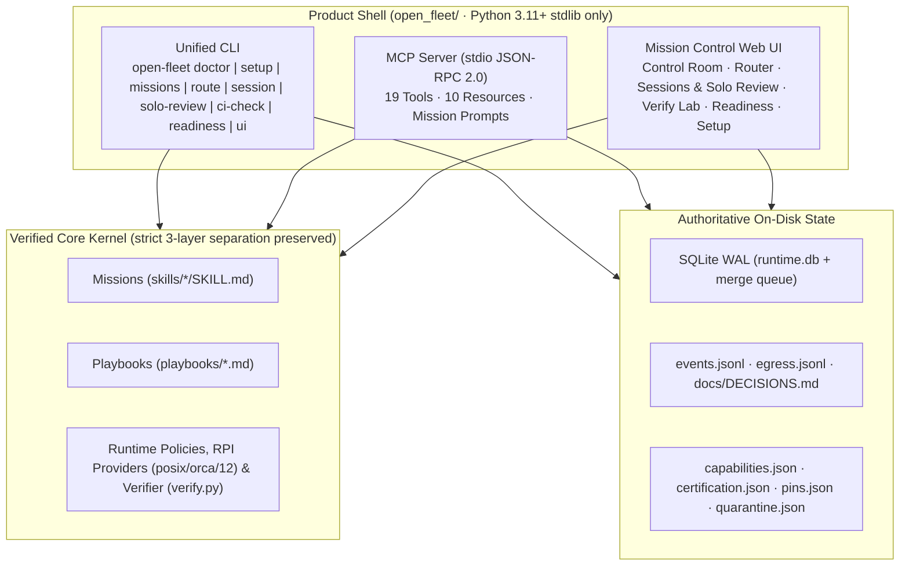

# open-fleet Product Blueprint: First-Principles Strategy & Agentic-Era Architecture

[Documentation Hub](README.md) · [CLI, MCP & Mission Control](cli-and-mcp.md) · [Architecture](../ARCHITECTURE.md) · [Product Roadmap](roadmap.md)

This document steps back from incremental hardening to answer a first-principles question: **how does `open-fleet` evolve from a rigorously verified doctrine and script catalog into a developer product people adopt in 60 seconds in the agentic era?**

---

## 1. First-Principles Diagnosis

### What `open-fleet` already built (the durable moat)

In 2026, coding-agent harnesses (Claude Code, OpenAI Codex CLI, Gemini CLI, OpenCode, Cursor, Antigravity) already commoditize single-session editing, git worktrees, and subagent delegation ([Platform-ride register](platform-ride.md)). None of them ship an **independent, tamper-resistant completion oracle**.

`open-fleet` already holds a uniquely strong verification and coordination kernel:

1. **Off-worker SHA-bound verification (`runtime/scripts/verify.py`)** — re-derives the frozen `T0` acceptance denominator from coordinator-held digests, checks `git merge-base --is-ancestor`, enforces `reviewed_sha == head_sha`, and executes throwaway-worktree **negative controls** (proving tests turn `RED` when the fix is reverted or mutated).
2. **Zero-daemon standalone POSIX runtime (`runtime/providers/posix.py` + `local_state.py`)** — SQLite WAL state (11 tables), lock-fenced 6-boundary crash recovery, git custody isolation (`gitexec.py`), and `ro` / `rw` / `danger` monotonic privilege profiles.
3. **Persisted fenced merge queue (`merge_queue.py`), quality-floor regression guard (`floor_guard.py`), signed one-way human decision ledger (`decisions.py`), and tamper-evident event log (`events.py`)**.

### Why developers bounce before seeing that value

A cold-start audit from `git clone` to first value exposes six structural adoption blockers:

| Blocker | Today's Reality | Product Consequence |
|---|---|---|
| **1. No installable package or single CLI** | Raw full-history `git clone` + 74 scattered scripts (`docs/runtime-scripts.md` is ~2,900 lines) + mixed `kebab-case`/`snake_case` names and 25+ env vars | High cognitive friction; cannot install via `uv tool install` / `pipx` / `pip` |
| **2. Half-automated setup** | `sh scripts/install.sh` requires manual JSON editing of `~/.claude/settings.json` (and hand-removing `_comment` keys) | Users either run without the completion gate or stack plugin + symlinks |
| **3. Hostile default runtime (`orca`)** | `OPEN_FLEET_RUNTIME` defaults to `orca` (an external desktop app) even though standalone `posix` is built-in and live-witnessed for both `ro` and `rw` | First-time users without Orca hit warnings and refusals immediately |
| **4. Prose-as-state-machine (35K token tax)** | Activating `ship-it` loads ~34,900 tokens before turn 1; the `#606` ablation measured ~62% token reduction when slimming activation load, while prose-only deferred reads were blocked 385 times across workspace boundaries | Burns context window and causes coordinators to hallucinate 10-flag bash commands |
| **5. Zero native MCP surface** | No MCP server despite every modern coding agent supporting native MCP Tools, Resources, and Prompts (and Risk R4 in `platform-ride.md` identifying MCP as the managed-hook escape hatch) | Agents cannot discover or call `open-fleet` primitives with typed JSON schemas |
| **6. Zero visual operator cockpit** | 16 SQLite tables + JSONL events + `DECISIONS.md` + `certification.json` sit on disk with no UI | Operators stare at scrolling terminal logs instead of inspecting fleet state, runs, and gates visually |

---

## 2. Adversarial Security & Reliability Closure (Post-#766–#788)

Before building the product shell, a four-track adversarial audit against `HEAD b95bade5` identified and closed concrete security bypasses, state-machine wedges, and drift:

### Critical (P0) Closures

- **Fetch sandbox bypass (`runtime/scripts/guard_text.py`):** Rejected path-qualified `argv[0]` binaries (e.g., `/tmp/evil/cat`, `./gh`), required explicit `-O -` / `--output-document=-` on `wget`, blocked `-e` and GNU prefix abbreviations (`--meth=POST`), and closed missing `curl` file-write/POST flags (`--stderr`, `--hsts`, `--etag-save`, `--libcurl`, `--expand-data`, `--alt-svc`).
- **Egress receipt bypass (`runtime/scripts/deny-hook.sh`):** Closed Rule 5 receipt spoofing via fake `./python3` interpreters, relative `egress.py` after `cd`, and peeled `PYTHONPATH`/`OPEN_FLEET_EGRESS_LEDGER` env overrides.
- **Guard-arming boundary forgery (`runtime/scripts/deny-hook.sh`):** Derived `--verify-settings` boundaries strictly from parsed hook assignments using runtime precedence, refused duplicate/conflicting worktree assignments, prevented ambient env contamination on JSON-settings harnesses, and added a positive in-boundary write probe in `rw` mode.
- **Negative-control phase oracle (`runtime/scripts/verify.py`):** Added `GIT_NO_REPLACE_OBJECTS=1` and `GIT_GRAFT_FILE=/dev/null` to `_Authority.nc_env()` and stopped `_stage_phase_repo` from copying `refs/replace/*`, `refs/notes/*`, and arbitrary unrelated worker refs into phase repositories.
- **External-adapter launch wedging (`runtime/providers/_external.py` + 9 adapters):** Moved pure validation before upstream calls and scoped runtime-contact marking to irreversible launch boundaries so pre-launch validation or guard failures release the task claim cleanly instead of wedging tasks in `dispatched`.

### High & Medium Closures (Summary)

- **Isolation & privilege boundaries:** Fixed `sandbox_doctor.py` top-level field shadowing and outer-envelope credential/privileged mount bypasses; wired guarded `HERMES_HOME` in `worktrunk.py`; enforced `worker_forbidden` and monotonic profile checks in `emdash.py`, `t3code.py`, `posix.py`, and `multiclaude.py`; closed `emdash.py` 4 GiB frame allocation DoS; closed GNU `rm --rec` prefix bypass in `deny-hook.sh`; extended W4-04 `record-root` to `worktrunk` and closed `HOME=/tmp` registry bypass in `spawn_identity.py`.
- **Custody, parsing & reliability:** Fixed `floor_guard.py` fail-open `cat-file -e` (`ls-tree`) and structural TOML/INI diffing for `pyproject.toml`/`setup.cfg`/`tox.ini`/`ruff.toml`; switched `decisions.py`, `gitexec.py:driver_blanks`, `preflight.py`, `dispatch-sign.py`, and `spawn_worker.sh` onto hardened git custody; fixed `live_broker.py` UTF-16/BOM depth & body-budget bypass; fixed `live_container.py` signal teardown fail-closed `EXIT_NOT_DESTROYED`; fixed `bundle.py` writing invalid builds into `--out`; fixed `run_index.py` tautological mission/tier binding checks; fixed `replay.py` missing `allow_static_nc`; fixed `posix.py` dropped `self.env` on `tmux`/`cmux` calls and `_terminate_backend` timeout/exception safety; fixed `orca_cli.py` `auto` timeout/resume & `OPEN_FLEET_CLI_COMMAND`; fixed `events.py` dropping multi-dispatch `worker_done` mail; fixed `watchdog.py` tick locking; fixed `OPEN_FLEET_TERMINAL_HANDLE` support in `send_msg.py`/`check_reply.py`/`hitl_ask.py`; fixed `get_provider("auto")` auto-detection; reconciled CI workflow pins and post-#766–#788 doc drifts in `docs/ops.md`, `docs/runtime-scripts.md`, `docs/runtimes.md`, and `docs/certification.md`.

---

## 3. Agentic-Era Four-Layer Product Architecture

Rather than breaking the existing three-layer doctrine (`skills/` · `playbooks/` · `runtime/`), `open-fleet` adds a **zero-dependency product shell (`open_fleet/` + `pyproject.toml`)** above the verified kernel:

### Core Product Design Principles

1. **60-Second Time-to-Proof:** A new user installs once (`pip install -e .` or `uv tool install .`), runs `open-fleet doctor` + `open-fleet demo`, and sees the independent verifier catch a gamed manifest live before configuring any API keys.
2. **`auto` Runtime UX Without Breaking Legacy Contracts:** `open-fleet` CLI, MCP server, and `setup` default to `OPEN_FLEET_RUNTIME=auto` (using Orca if installed, falling back seamlessly to standalone `posix`), while preserving `active_provider_name(env={}) == "orca"` for existing direct-script users and contracts.
3. **MCP-First Agent Ergonomics:** Coding agents call typed JSON-schema tools (`fleet_route_mission`, `fleet_preflight`, `fleet_verify_manifest`, `fleet_floor_check`, `fleet_diff_scope`, `fleet_status`) instead of memorizing 46 script paths or loading 35K tokens upfront.
4. **Atomic, Non-Destructive Setup:** `open-fleet setup --host claude --wire-hooks --wire-mcp` merges `Stop`/`TaskCompleted` hooks and MCP registration atomically, detects stacked plugin+symlink installs before creating duplicate hooks, and supports clean `--dry-run` and `--uninstall`.
5. **Evidence-Honest Visibility:** Mission Control surfaces live SQLite state, proof tiers, and exact `live-witnessed` vs `fixture-tested` vs `source-only` certification cells without inflating claims.

---

## 4. Product Execution Roadmap (Next 90 Days)

| Phase | Horizon | Focus | Concrete Deliverables & Exit Evidence |
|---|---|---|---|
| **Phase 0 (Shipped)** | Completed | Security & reliability closure | All 5 P0s + P1/P2 adversarial findings fixed with regression tests (`tests/test_adversarial_*.py`), `scripts/check.py` + `floor_guard.py` green |
| **Phase 1 (Shipped)** | Completed | Product shell & 60s onboarding | Root `pyproject.toml`, unified `open-fleet` CLI, zero-dep MCP server (`open-fleet mcp`), atomic multi-host `setup`/`doctor`, and live Mission Control UI (`open-fleet ui`) |
| **Phase 2 (Shipped)** | Completed | Progressive tool-backed missions, solo review & PR Action | Progressive MCP-backed mission state machines (`open_fleet/sessions.py`: <1,250 tokens/phase across all missions, ~96% average token reduction, fail-closed receipts + human-only one-way gates + `chain_check.py` terminal validation); honest solo-developer verified review lane (`open_fleet/solo_review.py`: `diff_scope` + `floor_guard` + irreversibility stop-list + build-blind cross-model packet + optional Lane-A `dark-eligible` `--execute-nc`); reusable PR verification composite GitHub Action (`.github/actions/open-fleet-verify/action.yml` + `open_fleet/ci_action.py`) |
| **Phase 3 (Workbench Shipped; Live Runs Ongoing)** | Ongoing | Proof graduation & multi-harness certification | Shipped honest readiness & probe workbench (`open_fleet/readiness.py`, CLI `open-fleet readiness`, MCP `fleet_readiness`, UI Readiness + Negative Probes + `certification.py check`). Live proof graduation of `doctrine-only` missions (`root-cause`, `deflake-it`, `floor-it`, `document-it`, `modernize-it`, `map-it`) and live container witness runs for `codex`/`gemini`/`opencode` remain evidence-gated behind real bound `docs/runs/` reports — never fabricated |
| **Phase 4 (Wheel Verified; Kernel Split Contracted)** | Next | Distribution & kernel modularization | Verified clean standalone wheel build (`pyproject.toml` + `ui_assets/index.html`) and fresh-venv out-of-repo CLI + MCP execution (`open-fleet`, `open-fleet-mcp`). Kernel decomposition of `verify.py` (5,228 lines) and `deny-hook.sh` (6,827 lines) is explicitly scoped for a dedicated `reshape-it` campaign honoring four pinned invariants: `verify.py` RV-D2 `PINNED_WIDTH = 91` (`tests/test_reshape_width_verify.py`), `_Transcript.TOOLCHAIN` hashing, `.coveragerc` >=80% in-process coverage, and `deny-hook.sh` single-file standalone copy compatibility (`verify_installed_guard` & `tests/test_deny_hook*.py`) |
