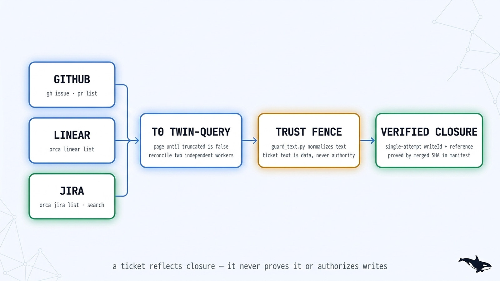

# Upstream & Orca v1.4.229 deep audit — 2026-10-17

Dated snapshot: 2026-10-17. Full source-level audit of every pinned upstream in
`runtime/pins.json` (`stablyai/orca`, `garrytan/gstack`, `mattpocock/skills`,
`addyosmani/agent-skills`, `agentbaseline/agentbaseline`), diffed from the 2026-10-13/14
pins to current upstream `HEAD` / latest releases, with disposition (`ADOPT`, `PATCH`,
`NOTE`, or `REFUSE`) per item.

  <picture>
    <source media="(prefers-color-scheme: dark)" srcset="../../assets/diagrams/tracker-enumeration.jpg">
    <source media="(prefers-color-scheme: light)" srcset="../../assets/diagrams/tracker-enumeration-light.jpg">
    
  </picture>

## 1. Executive summary & pin table

| Upstream | Old pin (2026-10-13/14) | New pin (2026-10-17) | Delta | Disposition |
|---|---|---|---|---|
| `stablyai/orca` | `v1.4.224` (`2bb20586ebc3`) | **`v1.4.229`** (`a0cd1644f320f1327f7495650a816111b495f3cd`) | 5 release tags (`v1.4.225`–`v1.4.229`), +26 CLI commands, +2 built-in skills (`orca-jira`, `jira-tickets`) | **PATCH + ADOPT**: re-pin to `v1.4.229` (`docs/runs/2026-10-17-pin-it-229.md`), replace the stale "no Jira CLI" claim in `playbooks/linear-enumeration.md`, fold `task_not_startable.failureCount`, `orca agent launch`, `orca reference`, `automations runs` paging, and OS terminal containment env vars (`ORCA_TERMINAL_PROCESS_CEILING`, `ORCA_TERMINAL_MEMORY_MAX`) into `runtime/*.md`. |
| `garrytan/gstack` | `v1.91.101.0` (`47d639abffa8`) | **`v1.91.121.0`** (`d258bcffb0cb7bda5f133f3e957f932d816d282f`) | 20 releases, 85 instruction + 26 permission-surface + 316 code files | **ADOPT**: rug-pull review clean (`changes-noted`); fold the `state-machines` round-trip matrix check (`kind × owner action → resulting row`) and `/cso --paths` scoping into `playbooks/risk-review.md`, and adopt the CAP4/CAP6 agent-ready error taxonomy in `docs/platform-ride.md`. |
| `mattpocock/skills` | `v1.3.1` (`24fe0ef7737e`) | **`v1.3.1+35`** (`49dd158d1076134a641b33efb035946536778336`) | 35 commits, 75 instruction + 5 permission-surface files | **ADOPT**: rug-pull review clean (`changes-noted`); fold forced-mutation `diff` proof into `playbooks/diagnose.md`, per-seam catches/misses notes into `playbooks/build-change.md`, `"yes"`-accepts-recommendation into `playbooks/decide-and-freeze.md`, and sub-issue parent linking into `playbooks/decompose-dag.md`. |
| `addyosmani/agent-skills` | `0.6.13` (`aeac41d4d005`) | **`0.6.13`** (`aeac41d4d005999432bb7312f7ff06383a91d59d`) | 0 commits (already at upstream `HEAD`) | **CURRENT**: re-witnessed 2026-10-17; existing rug-pull review holds. |
| `agentbaseline/agentbaseline` | `v1.0-draft` (`d842a1bb34a4`) | **`v1.0-draft`** (`d842a1bb34a42e9d7c0d54a1b12ead9e0e59e283`) | 0 commits (already at upstream `HEAD`) | **ADOPT (#560)**: close `VAL-01` (agent-specific security testing) by shipping the adversarial prompt-injection drill corpus (`evals/injection-drills.json`), runner (`scripts/eval.py --suite injection`), and unit suite (`tests/test_injection_drills.py`). |

---

## 2. `stablyai/orca` (`v1.4.224` → `v1.4.229`) deep delta

### 2.1 First-class `orca jira` CLI + `orca-jira` & `jira-tickets` skills (DRIFT-1)

- **Upstream source:** `src/cli/specs/jira.ts`, `skill-guides/orca-jira.md`,
  `skill-guides/jira-tickets.md`, `skills/orca-jira/SKILL.md`, `skills/jira-tickets/SKILL.md`.
- **What changed:** Orca v1.4.229 ships 19 `orca jira` commands:
  - Read/discover: `jira connection`, `jira issue <key> [--site <id>]`,
    `jira list [--filter assigned|reported|all|done] [--limit <n>] [--site <id>]`,
    `jira search <jql> [--limit <n>] [--site <id>]`, `jira project list|types|fields`,
    `jira comment list <key>`, `jira status list <key>`, `jira assignee list <key>`,
    `jira priority list [--project <key>]`.
  - Write: `jira create`, `jira comment add <key> (--body <text> | --body-file <path|->)`,
    `jira status set <key> (--to <name> | --to-id <transitionId>)`,
    `jira assignee set|clear`, `jira priority set|clear`, `jira label add|rm|set`.
- **Impact on `orca-fleet`:** `playbooks/linear-enumeration.md:67-75` previously taught
  *"Jira is a drawer, not a denominator source ... there is no Jira CLI behind this playbook"*.
  That claim is now **false** at v1.4.229.
- **Nuances vs. Linear that the playbook must state:**
  1. **Site scoping (`--site <id>`):** when multiple Jira sites are connected or share a project
     prefix, every command requires `--site <id>` from `jira connection --json`. Unlike Linear's
     `--workspace all`, Jira has no `all` fan-out.
  2. **Bounded reads (`--limit <n>`):** `jira list` and `jira search <jql>` return up to `--limit`
     (default 50) with no cursor flag; a T0 twin-query denominator on Jira must constrain the JQL
     so the returned count is strictly below `--limit` (else fail closed and narrow the JQL by
     project/component/key range).
  3. **Workflow transitions (`jira status list` → `jira status set`):** Jira moves through named
     workflow transitions (`--to <transition-name>` or `--to-id <id>`), not direct state
     assignment; only transitions returned by `jira status list <key> --json` are legal.
  4. **No `attach` subcommand:** unlike `orca linear attach`, `orca jira` has no link-attachment
     verb — the PR/MR URL goes into the single completion comment (`jira comment add <key> --body-file -`),
     and workspace-level linking uses `orca reference add --worktree active <url-or-jira-key>`.
  5. **Single-attempt non-idempotent writes:** on an uncertain write error, re-read `jira issue <key> --json`
     (or `jira comment list <key> --json`) before retrying.

### 2.2 `orca agent launch` & upgraded `worktree create --agent` (D229-2)

- **Upstream source:** `src/cli/specs/agent-launch.ts`, `src/cli/specs/core.ts:119-160`,
  `skill-guides/orca-cli.md`, `skill-guides/orchestration.md`.
- **What changed:**
  - `orca agent launch --agent <id> [--worktree <selector>] [--prompt <text>] [--model <id>] [--effort <level>] [--focus] [--retry-launch <operationId>] [--json]`
    starts an agent inside an existing worktree as a structured chat (`launch.outcome.kind = "structured"`)
    or terminal (`"terminal"`) per the user's Chat UI setting, replacing the old
    `terminal create --worktree active --command "<agent>"` recipe for interactive/standalone
    agent tabs.
  - `orca worktree create --agent <id>` now accepts `--model <id>`, `--effort <level>` (requires
    `--model`), `--retry-launch <operationId>`, and repeatable `--reference <url-or-jira-key>` +
    `--reference-site <id>`.
  - If a launch reply is lost, re-issuing with `--retry-launch <operationId>` from the error is
    idempotent; retrying without it creates a duplicate agent.
- **Disposition:** Supervised fleet units continue to use `orca orchestration worker-start` (or
  the unsupervised `terminal create` + `dispatch --inject` lane for `PROFILE=ro`). Document
  `agent launch`, `--retry-launch`, and `--reference` in `runtime/dispatch-lifecycle.md` and
  `runtime/orca-pin.md`.

### 2.3 `orca reference` workspace link management (D229-3)

- **Upstream source:** `src/cli/specs/reference.ts`, `skill-guides/orca-cli.md:105-123`.
- **What changed:** Four new commands:
  - `orca reference list [--worktree <selector>] [--json]`
  - `orca reference add <url-or-jira-key>... --worktree <selector> [--reference-site <id>] [--json]`
  - `orca reference remove [<url>...] [--key <key>...] --worktree <selector> [--json]`
  - `orca reference find <url-or-issue-key> [--worktree <selector>|--repo <selector>] [--include-archived] [--limit <n>] [--json]`
- **Why it matters to fleets:** `orca reference find <url-or-issue-key> --json` searches across
  workspaces (`linked: true` when attached, `linked: false` when matched by branch name) and
  returns the agents in each matching workspace with `liveness`, `terminal` handle, and `mailbox`
  (`dispatch:<id>` or `orca_session_id:<id>`). Coordinators and `liveness-resume` can locate an
  existing worktree/agent for an issue or PR without scanning every worktree manually.

### 2.4 `orca serve` supervision, OS service install, and cgroup/Job containment (D229-4)

- **Upstream source:** `src/cli/specs/serve.ts`, `src/cli/specs/terminal-daemon.ts`,
  `skill-guides/orca-cli.md:166-225`, `skill-guides/orca-per-workspace-env.md`.
- **What changed:**
  - `orca serve --supervise [--force]` respawns the headless server with exponential backoff on
    unexpected exits and records crashes under `<userData>/crash-logs/`.
  - `orca serve restore resume [--json]` resumes pending workspace restores after a crash.
  - `orca serve service install [--port <port>] [--pairing-address <ws-url>] [--command <path>] [--dry-run] [--json]`, `status [--json]`, and `uninstall [--json]`
    manage a login LaunchAgent (macOS) or systemd user unit (Linux).
  - `orca terminal-daemon status [--json]` and `orca terminal-daemon restart --yes [--json]`
    inspect and recover the out-of-process PTY host without restarting Orca.
  - **OS-level per-terminal resource containment on `orca serve`:**
    - `ORCA_TERMINAL_PROCESS_CEILING=<n>` (integer ≥ 64; `0`/`off` disables): caps process count
      per terminal via a systemd user scope on Linux or a Job object on Windows so a fork bomb in
      one worker cannot starve sibling workers or `orca serve`.
    - `ORCA_TERMINAL_MEMORY_MAX=<size>` and `ORCA_TERMINAL_MEMORY_SWAP_MAX=<size>` (bytes or
      `K`/`M`/`G`, ≥ `256M`, Linux systemd user scope): bounds per-terminal RAM and swap so an
      OOM killer terminates only the runaway worker terminal, never `orca serve`.
- **Impact on `orca-fleet`:** Directly strengthens Boundary 1 (Sandbox / resource isolation) in
  `runtime/sandbox-policy.md` and `runtime/threat-model.md`. While filesystem/credential isolation
  for `rw` workers remains worktree + deny-hook, Linux/Windows `orca serve` hosts now have real
  OS-enforced cgroup/Job-object process and memory ceilings per worker terminal.

### 2.5 Orchestration circuit-breaker & cleanup refinements (D229-5)

- **Upstream source:** `src/shared/orchestration-dispatch-refusal-contract.ts`,
  `skill-guides/orchestration/references/recovery-and-cleanup.md:118-167`.
- **What changed:**
  - `TaskNotStartableDetail` (`error.code == "task_not_startable"`) now includes
    `failureCount?: number` when the Task's 3-failure circuit breaker tripped, alongside
    `status`, `unmetDependencies`, and `retryOf`.
  - Failed `worker-start` attempts count across `--retry-of` toward the 3-failure circuit breaker,
    whereas a worker's own `worker_done --outcome failed` report does **not** increment the
    spawn-failure circuit breaker.
  - A `--retry-of` replacement for a `failed` worker automatically releases the terminal that the
    failed worker still owned, preventing zombie agent terminals from piling up (#27795).

### 2.6 Scheduled automations paging & terminal sleep-on-finish (D229-6)

- **Upstream source:** `src/cli/specs/automations.ts:114-130`, `skill-guides/orca-cli.md:155-162`.
- **What changed:**
  - `orca automations runs` now accepts `[--id <automation-id>] [--limit <n>] [--cursor <cursor>] [--json]`.
    Without `--limit` or `--cursor` it pages the full history automatically; passing either returns
    one page (≤ 100 runs) with `nextCursor`.
  - Finished automation runs now put their terminal to **sleep** instead of closing it (#28838),
    preserving the session history for inspection while freeing the live PTY.
- **Impact on `orca-fleet`:** Updates `runtime/mission-scheduling.md` so cross-run anti-inflation
  can page bounded windows (`--limit` / `--cursor`) and inspect sleeping automation terminals.

### 2.7 Other Orca v1.4.229 changes noted (D229-7)

- **`orca-chat-visuals` scratch directory:** `ORCA_CHAT_VISUALS_DIR` was renamed to
  `ORCA_CHAT_SCRATCH_DIR` (30-day automatic cleanup). No fleet script references it.
- **`orca skills install` / `orca skills update`:** Now accept `--agent <name>[,<name>]` and pin
  upstream skill installs to the exact Orca build commit (`<repo>/tree/<commit>`).
- **Schema version:** `SCHEMA_VERSION` in `src/main/runtime/orchestration/db/contract-constants.ts` remains `43`
  (unchanged from v1.4.224).

---

## 3. `garrytan/gstack` (`v1.91.101.0` → `v1.91.121.0`) deep delta

Full file-by-file inventory in
[`docs/research/pin-reviews/gstack-d258bcffb0cb7bda5f133f3e957f932d816d282f.md`](pin-reviews/gstack-d258bcffb0cb7bda5f133f3e957f932d816d282f.md).

1. **State-machine round-trip specialist (`review/specialists/state-machines.md`, `bin/gstack-state-matrix`):**
   - Born from a production data-loss postmortem (#6792): a diff that passed review routed
     `deactivate` and same-claim `replace` proposals down the `remove` branch, deleting user rows
     because only `remove` had a test.
   - **Protocol:** whenever a diff adds or changes a state machine (proposals, holds, approvals,
     queues, lifecycle transitions), enumerate the full `kind × action` matrix, write the expected
     resulting row from domain meaning (not from the code), and map each cell to a test (`path:line`)
     that exercises that exact `kind × action` and asserts the resulting state/row. Flag any
     untested cell, wrong row, or collapsed destructive branch as Critical.
   - **Adoption:** Folded into `playbooks/risk-review.md` (API-contract / Data-migration lens).
2. **Agent-ready error contract (`docs/agent-ready-errors.md`, `bin/gstack-error-capture`, `lib/dx-error-contract.ts`):**
   - Defines a 10-point error contract for CLI/API/MCP tools consumed by AI agents: `what`, `fix`,
     `example`, `code`, `channel`, `exit/status`, `retryability` (`retryable` + `side_effects`),
     `context`, `trace`, and `redaction`.
   - Hard score caps: **CAP4 (Critical)** if an error path leaks a secret, exits 0 on failure,
     recommends a destructive fix without warning, or hangs waiting for interactive TTY input without
     naming a non-interactive flag (`--yes`); **CAP6 (High)** if an error lacks fix/recovery/context.
   - **Adoption:** Referenced in `docs/platform-ride.md` and mirrored by `orca-fleet`'s own
     fail-closed scripts (`guard_text.py`, `verify.py`, `pin_review.py`).
3. **`/cso --paths` scoping & JSON secret redaction (`cso/SKILL.md`, `lib/cso/`):**
   - `/cso` now supports `--paths <dir,...>` and requires the report to name every skipped path
     explicitly so a scoped scan can never masquerade as a repo-wide clearance.
4. **Ship queue (`bin/gstack-ship-queue`, `lib/ship-queue.ts`) & approval classes (`lib/approval-classes.ts`):**
   - Local helpers for gstack's single-repo `/ship` and `/autoplan` workflows; `orca-fleet` already
     enforces serialized merge trains (`runtime/merge-serialization.md`) and mechanical/taste/one-way
     gate classification (`runtime/gate-classification.md`).

---

## 4. `mattpocock/skills` (`v1.3.1` `24fe0ef7` → `49dd158`) deep delta

Full file-by-file inventory in
[`docs/research/pin-reviews/mattpocock-49dd158d1076134a641b33efb035946536778336.md`](pin-reviews/mattpocock-49dd158d1076134a641b33efb035946536778336.md).

1. **Prove forced mutations landed in `diagnosing-bugs` (#1209):**
   - When a worker forces a red test by mutating production code or a fixture, it must `diff`
     against a pristine copy to prove the mutation actually landed before trusting the red.
   - **Adoption:** Folded into `playbooks/diagnose.md`.
2. **Per-seam catches/misses tradeoff note in `tdd` (#1192):**
   - Every proposed test seam carries a one-line note stating what it catches and what it misses.
   - **Adoption:** Folded into `playbooks/build-change.md` and `playbooks/decide-and-freeze.md`.
3. **Word grill questions so `"yes"` accepts the recommendation in `grilling` (#1193):**
   - Each frontier question is phrased so a bare `"yes"` unambiguously accepts the `➡️`
     recommended option.
   - **Adoption:** Folded into `playbooks/decide-and-freeze.md`.
4. **Attach decomposed tickets as sub-issues of a parent issue in `to-tickets` (#1188):**
   - When decomposing an existing tracker issue into slices, link each created ticket as a native
     sub-issue (`gh issue create --parent <parent>` / `gh issue edit <parent> --add-sub-issue <child>`).
   - **Adoption:** Folded into `playbooks/decompose-dag.md`.
5. **Search repo for all standards files & foreground review sub-agents in `code-review` (#1208):**
   - Already satisfied by `playbooks/acceptance-review.md` and `runtime/dispatch-lifecycle.md`.
6. **Unshipped `skills/in-progress/chief-of-staff` (`disable-model-invocation: true`):**
   - Single-session subagent/schedule coordinator draft; **refused** as a mission candidate per
     `docs/research/REJECTED.md` (no unit state machine, no convergence denominator, no SHA-bound
     evidence manifest).

---

## 5. Closing `#560` (`VAL-01` Agent-specific security testing)

In [`docs/research/2026-10-14-agent-baseline-assessment.md`](2026-10-14-agent-baseline-assessment.md),
`VAL-01` (*Agent-specific security testing*) was graded `GAP` because `guard_text.py` was unit-tested
on individual regexes, but the repository lacked an adversarial prompt-injection drill suite and
eval gate testing realistic multi-vector untrusted payloads (GitHub issues, PR review comments,
Jira tickets, CI logs, and web pages attempting instruction override, forged envelope breakouts,
Unicode tag/zero-width/fullwidth evasion, authority spoofing, and gate-skip suppression).

**Implemented in this upgrade:**
- `evals/injection-drills.json` (14 realistic adversarial drill cases) + `tests/fixtures/injection.json`
  (10-case poisoned-input corpus) across all four sources (`issue`, `pr`, `ci`, `web`), including
  Jira/Linear ticket bodies, multi-stage envelope-breakout attempts, Unicode NFKC/Cf obfuscation,
  fake coordinator `[GATE-GRANT]` / `SESSION_KIND: spawned` / `ORCA_COORD_ALLOW_DANGER=1`
  directives, secret-exfiltration asks, and benign technical lookalikes (negative controls that
  must **not** false-positive).
- `scripts/eval.py --suite injection` (and included in `--suite all`), plus
  `build_obedience_drill_prompt()` and `grade_obedience_verdict()`: runs the full drill corpus
  through `guard_text.py`, verifying 100% envelope containment, 0 un-defused forged banners,
  100% required pattern recall, 0 false positives on benign technical prose, and deterministic
  5-criterion grading for `review-it` (`PROFILE=ro`) obedience verdicts.
- `tests/test_injection_drills.py` and `tests/test_injection_corpus.py`: contract tests locking
  both corpora and the obedience verdict grader into `unittest` and CI.
