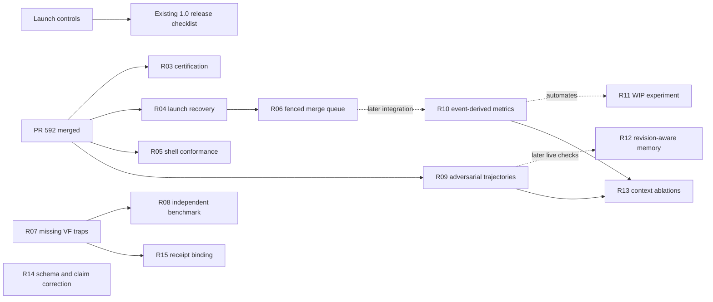

# Product roadmap

Updated 2026-10-20. The [research roadmap epic](https://github.com/ravidsrk/open-fleet/issues/593) and its linked issues are the live backlog; this page explains priority,
dependencies and completion criteria. Research-backed recommendations are proposed work,
not a new release authorization or a frozen implementation specification.

**Status, 2026-10-25: done.** All fifteen work packages and the epic are closed; the work-package
table gives each one's closing state, and the decisions table its current status. The rest of
this page is the 2026-10-20 plan as written, and [`roadmap-backlog.json`](roadmap-backlog.json)
keeps each package's entry state as of that date.

[Research and source checks](research/2026-10-20-product-roadmap-research.md) ·
[Dependency index](roadmap-backlog.json) ·
[Existing release epic](https://github.com/ravidsrk/open-fleet/issues/526)

## Direction

Make evidence-first fleets dependable for a new maintainer on a declared runtime,
then prove their value with independently reproducible evaluation. Keep the existing
mission / playbook / runtime architecture. The next investment is stronger operational
and experimental evidence for the catalog already shipped.

The recommendation is to prioritize public-beta reliability and adoption. This continues
the destination in [#526](https://github.com/ravidsrk/open-fleet/issues/526). Each implementation still freezes its own scope through the
existing process; release, credential, spending and policy gates retain their owners.

## What changed since the previous roadmap

Research began against main `42d28e4c` and [PR #592](https://github.com/ravidsrk/open-fleet/pull/592)
at `d9787142`. That PR has since merged into main as
[`38aed6a6`](https://github.com/ravidsrk/open-fleet/commit/38aed6a6ef4a8873ef70504336976fd47dc3de87),
satisfying the prerequisite for R03, R04, R05 and R09. The dated source briefs retain
their original inspection snapshots.

| Previous work | Verified status and next action |
|---|---|
| 0.7.0 packaging and receipt-tree shrink | v0.7.1 is published; lean-install witness landed in #554. Preserve the evidence. |
| Linux first mission (#527) | Closed with the Ubuntu review-it witness. Do not recreate. |
| External ship-it and review-it (#515, #529) | Both now have binding reports. The proof snapshot is 2 external-run, 3 self-run, 17 doctrine-only; this is not certification of every runtime. |
| Runtime portability (#577–#590, merged #591) | Adapters exist. Next: certify installed routes and crash recovery, not add another provider list. |
| External CI monitor (#528) | Implementation and manual drill exist; scheduled activation remains owed. Reuse this issue. |
| Independent reviewer (#530) | CODEOWNERS configuration landed; H-10 acceptance and a real approving review remain owed. R02 tracks that distinct remainder. |
| Trusted verdict gate (#452) | Workflow exists; required checks still name `verdict`, not the dedicated `verdict-gate` identity. R01 completes deployment. |
| Runtime pin (#508) | Current record is Orca v1.4.238 witnessed 2026-10-24. The weekly probe files the next re-pin: 2027-01-24 (`orca.next_review`), a minor, or ten patches behind; parks carried. |
| Marketplace (#235) | Existing human action; copy should use the current proof status. No duplicate submission issue. |

The September catalog-completion definition remains historical and frozen. The October 9
and October 18 research remains dated history. This roadmap is the current synthesis;
the linked research report records sources, rejected directions and access limitations.

## Delivery order

Time windows below are planning estimates after work starts, assuming one primary
maintainer and occasional independent review. They are not release dates. S = about
one day, M = several focused days, L = one or more weeks; live environments and human
availability may dominate. Run only a small active frontier, not all packages at once.

### W0 — close the remaining launch controls

Target window: first 1–2 weeks, subject to maintainer availability.

Reuse #528 for the external scheduled monitor; complete [R01 / #594](https://github.com/ravidsrk/open-fleet/issues/594) and [R02 / #595](https://github.com/ravidsrk/open-fleet/issues/595). Keep the current
public-beta gate list authoritative: #528 and the day-of-posting proof recheck still
gate announcement. [R01 / #594](https://github.com/ravidsrk/open-fleet/issues/594)/[R02 / #595](https://github.com/ravidsrk/open-fleet/issues/595) are recommended before the 1.0 cut; adding either to the
beta announcement gate needs an explicit maintainer decision.

Exit evidence: a real scheduled monitor heartbeat plus alert drill; settings read-back
and a negative spoofed-check control; actual independent review tied to a PR head.
Then follow the existing release checklist at the cut SHA. Do not close [#526](https://github.com/ravidsrk/open-fleet/issues/526) merely
because a roadmap or green CI exists.

### W1 — prove portable runtime behavior

Target window: following 2–6 weeks. Begin with [R03 / #596](https://github.com/ravidsrk/open-fleet/issues/596)'s POSIX/Orca fixture and first-run
path, [R04 / #597](https://github.com/ravidsrk/open-fleet/issues/597)'s launch-recovery seam, and [R05 / #598](https://github.com/ravidsrk/open-fleet/issues/598)'s differential shell corpus. [R06 / #599](https://github.com/ravidsrk/open-fleet/issues/599) follows [R04 / #597](https://github.com/ravidsrk/open-fleet/issues/597)
because both change persistent coordination state.

Exit evidence: supported routes have versioned certification receipts and honest
unknown cells; launch crash windows reconcile without duplicate workers or lost commits;
literal shell examples stay usable while executing forbidden substitutions are denied;
the merge queue refuses stale owners and stale reviewed trees.

### W2 — make verification and operating cost independently measurable

Target window: overlapping W1 where dependencies allow, roughly weeks 3–8.

[R07 / #600](https://github.com/ravidsrk/open-fleet/issues/600) extends existing VF-Bench invariants. [R08 / #601](https://github.com/ravidsrk/open-fleet/issues/601) makes comparison reproducible with
held-out custody. [R09 / #602](https://github.com/ravidsrk/open-fleet/issues/602) tests adversarial actions over real fixture trajectories. [R10 / #603](https://github.com/ravidsrk/open-fleet/issues/603)
derives metrics from stable observations; [R11 / #604](https://github.com/ravidsrk/open-fleet/issues/604) runs the already specified WIP experiment.

Exit evidence: every named invariant has an isolated trap or explicit gap; external
results distinguish unsupported cases from failures; attacks are scored on observed
actions/state; at least three varied-WIP runs have recomputable metrics. A small public
corpus passing is not a universal soundness proof, and absent usage data is not zero cost.

### W3 — improve context and interoperability on that evidence

Target window: roughly weeks 6–12, depending on W2 results.

[R12 / #605](https://github.com/ravidsrk/open-fleet/issues/605) makes historical hints revision-aware; its deterministic fixtures can start earlier.
[R13 / #606](https://github.com/ravidsrk/open-fleet/issues/606) tests smaller activation loads without
weakening mandatory gates. [R14 / #607](https://github.com/ravidsrk/open-fleet/issues/607) corrects and validates the A2A boundary. [R15 / #608](https://github.com/ravidsrk/open-fleet/issues/608) binds offline
retention receipts to inventory bytes. [R14 / #607](https://github.com/ravidsrk/open-fleet/issues/607)'s format/documentation correction can start
earlier; it does not need a live service.

Exit evidence: stale or malicious history cannot become authority; an instruction-load
recommendation preserves task/safety outcomes; protocol claims pass the pinned schema;
retention receipt verification rejects wrong inventories/identities. Performance gains,
live protocol service support and legal conformance are not assumed.

## Work packages

| Issue | Work package | Wave / size | Hard prerequisite | State (2026-10-25) |
|---|---|---|---|---|
| [R01 / #594](https://github.com/ravidsrk/open-fleet/issues/594) | Activate the trusted verdict-gate identity in branch protection | W0 / S | — | Closed 2026-10-24 |
| [R02 / #595](https://github.com/ravidsrk/open-fleet/issues/595) | Complete the independent-maintainer review witness for H-10 | W0 / S | — | Closed 2026-10-24: OpenAI Codex is the reviewer of record |
| [R03 / #596](https://github.com/ravidsrk/open-fleet/issues/596) | Publish witnessed provider and harness certification with a reproducible first-run path | W1 / L | [PR #592](https://github.com/ravidsrk/open-fleet/pull/592) (merged) | Closed 2026-10-25; its one owed Orca cell moved to #680 |
| [R04 / #597](https://github.com/ravidsrk/open-fleet/issues/597) | Reconcile POSIX worker launch after crashes at enumerated lifecycle boundaries | W1 / M | [PR #592](https://github.com/ravidsrk/open-fleet/pull/592) (merged) | Closed 2026-10-23 |
| [R05 / #598](https://github.com/ravidsrk/open-fleet/issues/598) | Differential-test deny-hook shell parsing against real shell behavior | W1 / M | [PR #592](https://github.com/ravidsrk/open-fleet/pull/592) (merged) | Closed 2026-10-24 |
| [R06 / #599](https://github.com/ravidsrk/open-fleet/issues/599) | Persist and fence the single-conductor merge queue | W1 / L | [R04 / #597](https://github.com/ravidsrk/open-fleet/issues/597) | Closed 2026-10-23 |
| [R07 / #600](https://github.com/ravidsrk/open-fleet/issues/600) | Cover the remaining verifier invariants with isolated VF-Bench traps | W2 / M | — | Closed 2026-10-23 |
| [R08 / #601](https://github.com/ravidsrk/open-fleet/issues/601) | Make VF-Bench independently runnable with held-out and temporal evaluation | W2 / L | [R07 / #600](https://github.com/ravidsrk/open-fleet/issues/600) | Closed 2026-10-24 |
| [R09 / #602](https://github.com/ravidsrk/open-fleet/issues/602) | Evaluate adversarial worker trajectories using observed actions and state | W2 / L | [PR #592](https://github.com/ravidsrk/open-fleet/pull/592) (merged) | Closed 2026-10-25: live arm bound, every attack 5/5 PASS |
| [R10 / #603](https://github.com/ravidsrk/open-fleet/issues/603) | Derive run and wave metrics from an append-only event record | W2 / M | — | Closed 2026-10-23 |
| [R11 / #604](https://github.com/ravidsrk/open-fleet/issues/604) | Measure the WIP throughput curve before changing fleet concurrency defaults | W2 / M | — | Closed 2026-10-25: measured; mutation-wave caps kept |
| [R12 / #605](https://github.com/ravidsrk/open-fleet/issues/605) | Bind episodic memory hints to source revision and untrusted provenance | W3 / M | — | Closed 2026-10-24 |
| [R13 / #606](https://github.com/ravidsrk/open-fleet/issues/606) | Measure instruction-load reductions with paired mission ablations | W3 / M | [R09 / #602](https://github.com/ravidsrk/open-fleet/issues/602), [R10 / #603](https://github.com/ravidsrk/open-fleet/issues/603) | Closed 2026-10-25: measured; current activation kept |
| [R14 / #607](https://github.com/ravidsrk/open-fleet/issues/607) | Correct and validate A2A export against a pinned official schema | W3 / M | — | Closed 2026-10-23 |
| [R15 / #608](https://github.com/ravidsrk/open-fleet/issues/608) | Verify provenance retention receipts against the signed inventory offline | W3 / M | [R07 / #600](https://github.com/ravidsrk/open-fleet/issues/600) | Closed 2026-10-23 |

Start with [R07 / #600](https://github.com/ravidsrk/open-fleet/issues/600)'s invariant fixtures, [R14 / #607](https://github.com/ravidsrk/open-fleet/issues/607)'s schema/claim correction, and [R03 / #596](https://github.com/ravidsrk/open-fleet/issues/596)'s
bounded first-run path. [R05 / #598](https://github.com/ravidsrk/open-fleet/issues/598) can now build its differential corpus
against the merged fixes from [PR #592](https://github.com/ravidsrk/open-fleet/pull/592).
Human-owned W0 work can proceed alongside these.

Dependencies express delivery order, not permission to change scope. The state-writing
chain is [R04 / #597](https://github.com/ravidsrk/open-fleet/issues/597) -> [R06 / #599](https://github.com/ravidsrk/open-fleet/issues/599); integrate those receipts into [R10 / #603](https://github.com/ravidsrk/open-fleet/issues/603) after they land. Keep verifier
changes [R07 / #600](https://github.com/ravidsrk/open-fleet/issues/600) -> [R15 / #608](https://github.com/ravidsrk/open-fleet/issues/608) serialized. [R10 / #603](https://github.com/ravidsrk/open-fleet/issues/603)'s initial metrics, [R11 / #604](https://github.com/ravidsrk/open-fleet/issues/604)'s manually evidenced baseline,
[R12 / #605](https://github.com/ravidsrk/open-fleet/issues/605)'s currentness fixtures, and [R09 / #602](https://github.com/ravidsrk/open-fleet/issues/602)'s offline adversarial fixtures can start independently.
[R10 / #603](https://github.com/ravidsrk/open-fleet/issues/603) then automates subsequent WIP measurements; [R09 / #602](https://github.com/ravidsrk/open-fleet/issues/602) supplies later live memory attack
checks. [R03 / #596](https://github.com/ravidsrk/open-fleet/issues/596)'s wider live matrix is incremental, not a block on all other work. Policy caps,
default-branch promotion and changes to trust roots remain separately gated.

## Decisions and bounds

This roadmap records research, issue creation and planning. Publishing it does not
freeze implementation scope or authorize deployments, paid experiments, changes to
required checks or signing keys, or a beta announcement. Those decisions retain
their existing human gates.

| Decision | Recommendation | Status |
|---|---|---|
| Primary investment | Reliability and empirical proof, then broader adoption | Working recommendation; priority confirmation not recorded |
| Expanded beta gates | Keep the current announcement gates; complete R01/R02 before 1.0 | R01 and R02 closed 2026-10-24; any other gate change is the maintainer's |
| Live experiment budget and independent corpus custodian | Specify per experiment before paid/model-dependent runs | Authorised per experiment (USD 50 for #602, 150 for #604, 750 for #606); OpenAI Codex holds VF-Bench's held-out set (#601) |
| A2A transport/server scope | Correct the offline descriptor and schema claim first | Descriptor corrected (#607); a real service remains unspecified |
| Default concurrency / instruction cap | Keep current values until R11/R13 supply evidence | Measured: R11 and R13 both recommend keeping the current values; any revision is a separate decision |

Deliberately deferred: new missions, additional unvalidated adapters, a hosted SaaS,
automatic memory-to-policy promotion, auto-merge to default, and compliance certification.
The research did not establish a customer mandate for those investments.

## Plan review

Alternatives considered: (A) finish launch paperwork only (smallest cost, leaves runtime
assurance gaps); (B) reliability and measurement on the current catalog (recommended,
reuses the implementation and existing gates); (C) expand catalog/providers or build a
hosted control plane (largest scope, weak evidence of incremental value).

Review sequence: scope, developer experience, then engineering, each by a reader
who did not write the plan. No separate visual-design lens was needed for this
documentation/backlog change. Scope review clarified unexpected skips and unblocked
manual WIP evidence. DX review narrowed the first-run and benchmark deliverables and
separated hard dependencies from later integration. Engineering review required
stale-conductor tests at the actual remote-effect boundary and controlled experiment
ordering. Those changes are incorporated in the issue acceptance criteria.

Premises for implementation planning: retain the existing product architecture and
release contract; prioritize assurance of implemented runtimes; measure before changing
caps or instruction load. These are proposed premises, not a recorded human freeze.

VERDICT: proposed roadmap and issue backlog; not a human-frozen execution plan.
UNRESOLVED DECISIONS: priority confirmation; any beta gate change; paid experiment budgets
and corpus custodian; future transport/server scope; release approval.
